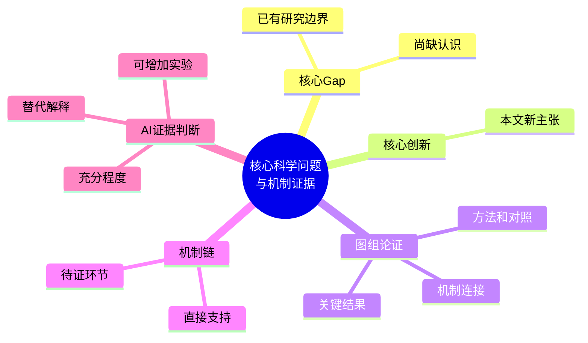

# 📄 <论文标题>

> [!info] 论文信息与阅读入口
> **作者**：<作者>
> **期刊与年份**：<期刊>（<年份>）
> **DOI**：[<DOI>](https://doi.org/<DOI>)
> **文章类型**：<神经/免疫/代谢/组学/药理，可多选>
> **模型系统**：<细胞/动物/类器官/组织/体外体系>
> **核心机制轴**：<已核验机制概要>
> **Zotero**：[条目](<zotero_uri>) · [PDF](<pdf_uri>)
> **全文**：[[fulltext/<集合>/<父条目键>|原文 Markdown]]

> [!note] 来源与阅读范围
> 本页为AI精读；原文发现须对应具体来源，AI解释和后续建议明确标注。<记录实际可访问主文、图表及补充材料范围；缺失时说明。>

## 🧭 研究方向相关性

- **总体相关性**：<相关/不相关>
- **对应研究方向**：<从research_directions列出，可多选>
- **相关性理由**：<说明研究对象、机制或模型与方向的直接联系；不因广泛联想增加分类>
- **可迁移内容（AI建议）**：<有材料依据的机制/模型/思路；与用户研究的联系仍是建议>
- **标签记录**：<由research_directions派生相同Obsidian/Zotero层级标签，例如研究方向/实体瘤CAR-T；如未写回则待同步>

## 🎯 核心摘要

> [!abstract] 核心概括
> <3–5句说明Gap、关键发现、证据方式、核心结论及必要边界。>

### 📊 质量评分（AI暂定）

<简短说明五项评分理由；质量属性可修改。0表示尚未评分。>

```dataviewjs
const q = dv.current().quality_dimensions ?? {};
const labels = {
  novelty: "创新性",
  evidence_chain: "证据链完整性",
  methodological_rigor: "方法严谨性",
  reproducibility: "可重复性",
  transferability: "可迁移性"
};
const scores = Object.entries(labels).map(([key, label]) => ({
  label, value: Number(q[key] ?? 0)
}));
const valid = scores.filter(x => Number.isFinite(x.value) && x.value >= 1 && x.value <= 5);
if (valid.length === scores.length) {
  const mean = valid.reduce((sum, x) => sum + x.value, 0) / valid.length;
  const starCount = Math.round(mean);
  dv.paragraph(`总体质量：${"★".repeat(starCount)}${"☆".repeat(5 - starCount)}（${mean.toFixed(1)}/5）`);
} else {
  dv.paragraph(`评分待完善：已填写 ${valid.length}/${scores.length} 项。`);
}
dv.table(["维度", "分数"], scores.map(x => [x.label, x.value === 0 ? "待评分" : `${x.value}/5`]));
```

## 1. 🕳️ 核心 Gap 与科学问题

### 1.1 领域背景与已有研究边界

- **研究场景与已有共识**：<已知的细胞互作、疾病背景、过程或治疗障碍>
- **既有研究解释到哪里**：<概括本文Introduction援引的关键认识，标原文参考文献编号>
- **尚不能解释什么**：<具体矛盾现象、缺失机制环节、因果/来源/时序/模型边界>

### 1.2 核心 Gap

> [!question] 核心缺口
> <明确缺少哪一条认识或证据；不以“研究较少”代替科学缺口。>

- **问题如何提出**：<Introduction的逻辑与本文观察怎样引出问题；标原文节或图>
- **为什么值得解决**：<解决后对机制理解或研究策略的具体价值>

### 1.3 科学问题与假说

- **核心科学问题**：<问句>
- **作者假说**：<来自原文；未明确时标为AI归纳而非作者原话>
- **关键变量与预期机制**：<刺激/来源/响应/功能结果之间的关系>

## 2. 💡 核心创新点简述

### 2.1 创新点 1：<清晰主张>

- **创新主张**：<本文具体新增的发现、机制或策略>
- **与已有研究的差异**：<既有研究已解释什么、其边界在哪里、为何必须解决当前问题，以及本文把认识推进到哪一步；援引来源要标明>
- **对应科学问题**：<该创新点回答的问题>

### 2.2 创新点 2：<清晰主张>

- **创新主张**：<内容>
- **与已有研究的差异**：<边界、缺口、问题重要性及推进>
- **对应科学问题**：<问题>

<!-- 只按论文实际创新数增删这些三项简述，不追加独立方法/证据表或创新评估章节。 -->

## 3. 📈 图组解析与阶段证据判断

> [!tip] 阅读方式
> 按原文Results的论证顺序推进。每个主图小面板用1–3句话写方法、分组、结果；不列样本量或重复数。几个面板完成一个发现/机制环节后立即总结、判断，再继续后续面板。补图或本文引用的既有研究只融入对应论证位置。

### Figure 1：<主题>

<有可核验配图时在这里嵌入真实图片路径。>

**A**：<1–3句话：方法/模型、比较分组、主要结果。>

**B**：<1–3句话：方法、分组、结果。>

**C**：<1–3句话：方法、分组、结果。>

> [!important] 阶段总结与证据判断：<本图组完成的发现/机制环节>
> **支持到哪一步**：<Fig.1A–C如何共同支持某创新点的一个环节；只用真实面板号。>
> **与其他证据的连接**：<关联之前/跨图的主图面板、相关补图，以及本文援引的前人研究。区分本文数据、补充未核验信息和已有报道。>
> **AI证据判断与可补充实验**：<充分/部分充分/不足及原因；还缺什么关键区分证据，增加什么实验能解决。>

**D**：<继续后续面板的1–3句话解析。>

**E**：<1–3句话解析。>

> [!important] 阶段总结与证据判断：<下一机制环节>
> **支持到哪一步**：<结果整合及对应创新点。>
> **与其他证据的连接**：<确有联系时引用先前图/补图/既有研究，不强行补齐。>
> **AI证据判断与可补充实验**：<剩余解释空间和有针对性的实验。>

### Figure 2：<主题>

**A**：<方法、分组、结果。>

**B**：<方法、分组、结果。>

> [!important] 阶段总结与证据判断：<图组主张>
> **支持到哪一步**：<证据整合。>
> **与其他证据的连接**：<实际可定位来源。>
> **AI证据判断与可补充实验**：<结论力度、局限和实验。>

<!-- 按实际面板和Results逻辑续写。主表存在时在相应论证位置解释，不另建补充图表章。 -->

## 4. 🔗 机制证据链

<来源/刺激> → [[分子A]] → <响应/代谢事件> → <细胞行为> → <功能后果>

- **证据最强的环节**：<具体图组与因果干预>
- **证据最弱或待证的环节**：<相关、间接、特异性或模型适用限制>
- **尚缺的关键证据（AI判断）**：<最有区分力的验证>

## 5. ⚖️ 结论逐句拆解

<写明Conclusion或Discussion实际取句位置；没有独立Conclusion时说明。>

### 结论句 1

- **英文原文**："<真实定位的完整句>"
- **中文翻译**：<准确翻译并保留限定>
- **证据来源**：<具体主图/补图/正文位置与全文入口；仅有已核验PDF页码时加入页码>
- **证据链解释**：<作者为何能从这些结果提出该结论>
- **推断边界**：<相关/因果/模型/转化范围>

<!-- 按结论段完整句意增添，不反向生成英文引句。 -->

## 6. 🗣️ 局限性与后续研究

- **作者承认的局限**：<原文可定位内容>
- **模型与技术边界（AI评估）**：<直接影响解释/外推的限制，不罗列样本量>
- **因果局限与替代解释（AI评估）**：<尚缺的阻断/救援/特异性>
- **后续研究建议（AI建议）**：<有针对性的验证问题和目的>

## 7. 🔗 关联知识与个人笔记

- **核心概念与通路**：[[<概念>]]、[[<通路>]]
- **相关论文或既有笔记**：<只有真实笔记使用实际路径双链；否则列已核验题名/DOI>
- **可迁移线索（AI建议）**：<明确适用条件，个人是否采纳由用户决定>

<!-- critical-reading:personal-link:start -->
> [!note] 个人思考
> [[Notes/<论文文件名> — 我的思考|打开我的个人笔记]]
> 个人正文由你自由记录；论文证据以本页与原文为准。
<!-- critical-reading:personal-link:end -->

## 📚 参考文献精选

<选择真正与Gap/机制/可迁移方法相关的原文参考文献，列原文编号、作者、题名、期刊、年份和可核实DOI；注明是否仅由本文援引。>

## 🧠 机制思维导图



> [!summary] 阅读状态
> **完成范围**：<真实已读/核验材料；补充未取得不能称100%完成>
> **总体评分**：由Dataview自动计算。
> **AI暂定判断**：<价值与边界>
> **一句话 takeaway**：<最值得记住的科学认识>
